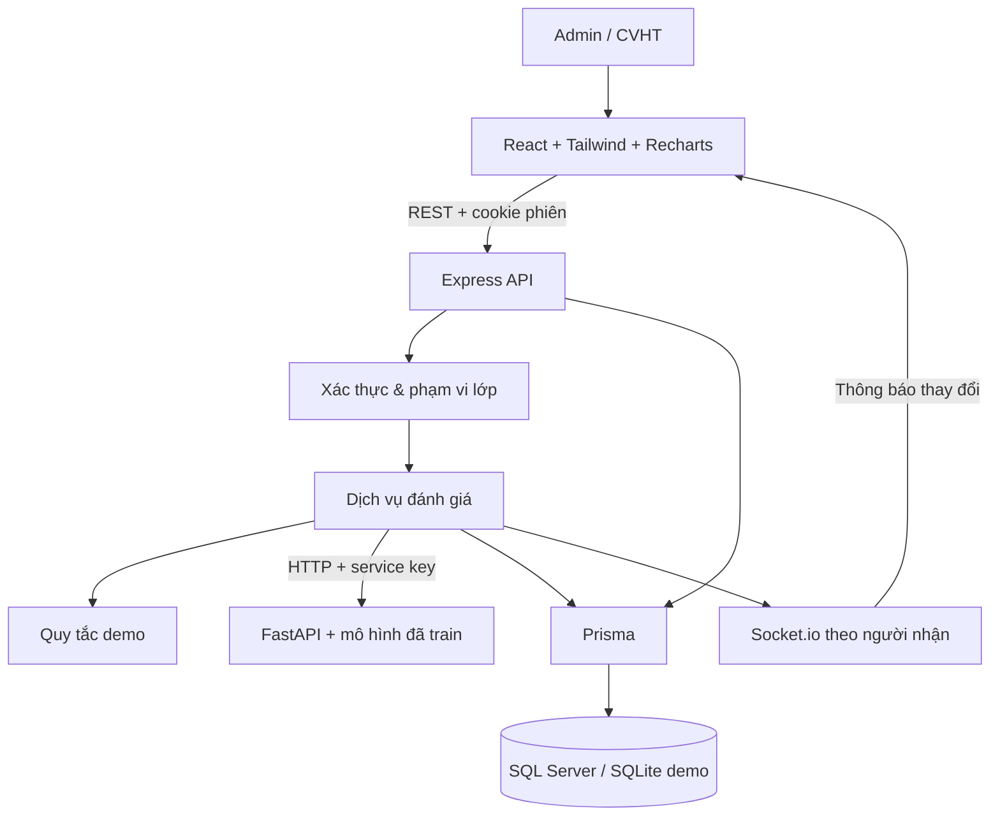
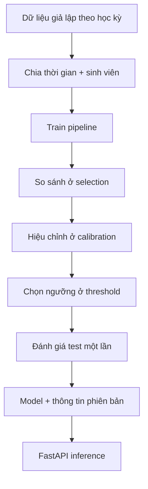
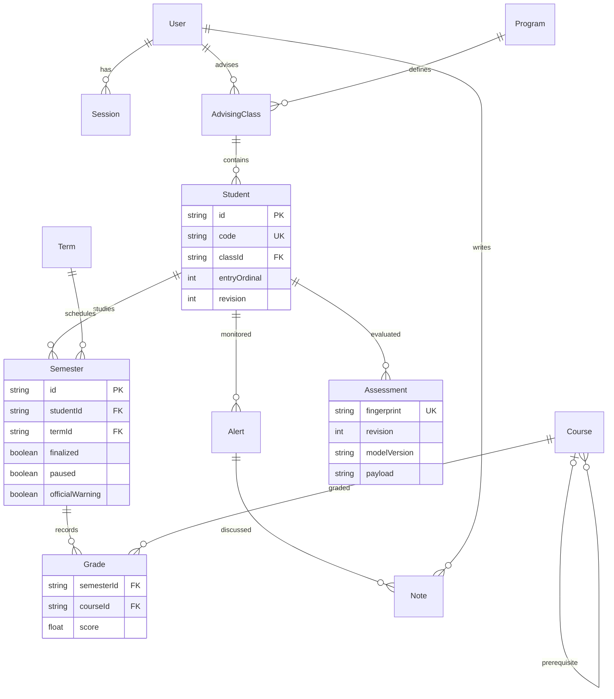
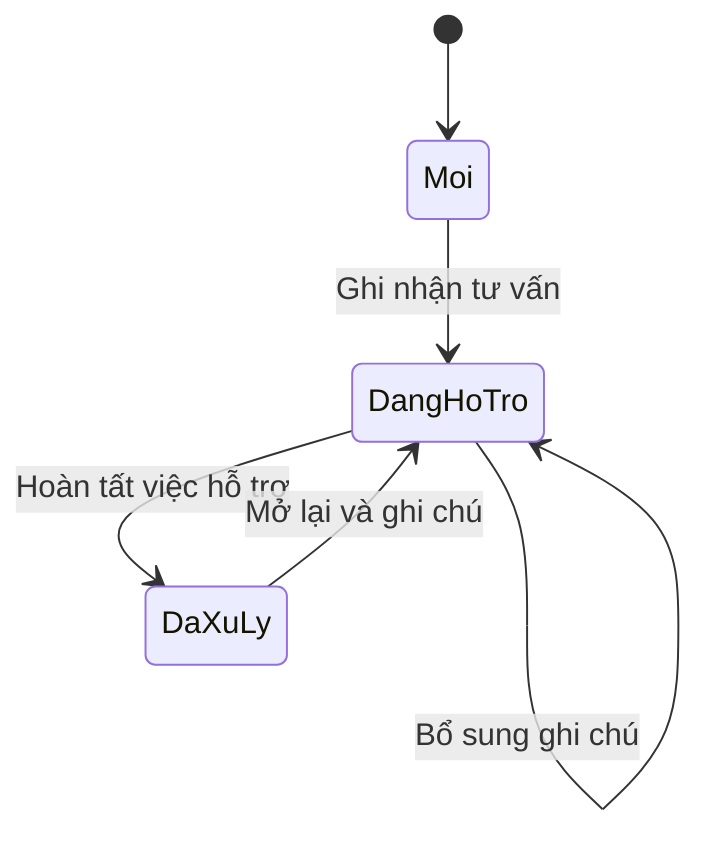

# Kiến trúc, dữ liệu và các sơ đồ

## Kiến trúc chạy ứng dụng



Không expose service key đến React. Client nhận sự kiện rồi tải lại API được kiểm tra quyền. Database là nguồn lưu bền vững, không dùng Socket thay database.

## Huấn luyện ngoại tuyến



Train không diễn ra khi bấm Đánh giá. Model artifact chứa model, calibrator, trung vị train, feature schema và metadata. Chỉ nạp artifact do nhóm tạo và tin cậy; joblib không phải định dạng an toàn cho file không rõ nguồn.

## ERD



Audit là bảng nhật ký riêng lưu actorId, subjectId, action, details trước/sau. Không gắn cascade delete; bản demo không xóa sinh viên hoặc tài khoản chứa lịch sử. Các chuỗi payload/notes dùng NVARCHAR(MAX) ở SQL Server, trường khóa giới hạn 191 ký tự để tránh khóa index quá dài.

## Trình tự nhập điểm và đánh giá

```mermaid
sequenceDiagram
  participant A as Admin
  participant B as Backend
  participant D as Database
  participant M as ML
  participant C as CVHT
  A->>B: Lưu bảng điểm học kỳ
  B->>B: Xác thực, kiểm tra dữ liệu
  B->>D: Transaction điểm + revision + audit
  D-->>B: Commit
  B->>B: Tính GPA, CPA, quy tắc, features
  B->>M: Dự báo kỳ tiếp theo
  alt Mô hình sẵn sàng
    M-->>B: Điểm, level, phiên bản, độ nhạy
  else Timeout hoặc lỗi
    B->>B: ML = UNAVAILABLE
  end
  B->>D: Kiểm tra revision; lưu đánh giá, cảnh báo
  B-->>C: Socket: academic:update
  C->>B: Tải lại dữ liệu theo quyền
  B-->>A: Kết quả lưu và đánh giá
```

## Trạng thái xử lý cảnh báo



Risk level và active được cập nhật từ đánh giá, độc lập workflow. Không xóa note khi mức nguy cơ giảm. Cảnh báo được gắn kỳ để không nhầm lịch sử với hiện tại.

## Tổ chức code và pattern

| Cách tổ chức | Vị trí | Lợi ích |
|---|---|---|
| Service layer | assessment.mjs | Một nơi điều phối tính điểm, ML, persistence, notification |
| Dependency injection | createApp(db,cfg,{predict,notify}) | Test lỗi ML và phạm vi realtime mà không giả DB |
| Strategy đơn giản | rules và predict | Kiểm tra hiện tại/dự báo có hợp đồng riêng |
| Observer / pub-sub | Socket.io academic:update | UI cập nhật khi có thay đổi |
| Pipeline | sklearn Pipeline | Tiền xử lý thống nhất train/inference |
| Repository qua ORM | PrismaClient | Truy vấn typed schema, transaction, đổi provider |

Không tự thêm lớp factory/singleton cho mọi entity. Đây là hệ thống lớp demo với hai dịch vụ, không cần gọi là hệ microservice đầy đủ.
